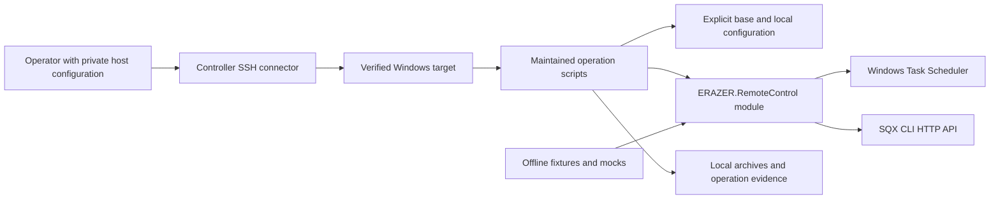

# Implemented design

This describes published module **1.0.1**, not the current state of a remote PC.
The toolkit runs natively on Windows. It controls an installed SQX application;
it is not a market-data provider, trading engine or strategy-quality validator.

## Components and boundaries

The arrows show intended invocation relationships, not a deployed service mesh.
The root connector is controller-side. SQX scripts must run on the intended host;
loopback on the controller cannot inspect the target. The CLI API helpers and the
private authenticated GUI monitor are different interfaces. No Python web server
or public authentication service is provided by this repository.

| Layer | Responsibility | Important limit |
| --- | --- | --- |
| [Core.ps1](../src/ERAZER.RemoteControl/Core.ps1) | Explicit config merge, Windows quoting, task inspection/action specifications | Import does not register tasks; COM inspection failures retain their category |
| [Sqx.ps1](../src/ERAZER.RemoteControl/Sqx.ps1) | Command grammar, HTTP origin validation, status parsing/readiness, native engine invocation | A ready CLI response is required; GUI telemetry is a separate integration |
| [Proxy.ps1](../src/ERAZER.RemoteControl/Proxy.ps1) | Pure proxy decision plus separate WinINET/WinHTTP/INI effects | A reachable TCP socket does not prove target internet or vendor authorization |
| [ProjectArchive.ps1](../src/ERAZER.RemoteControl/ProjectArchive.ps1) | Rebuild an offline ZIP project with verification before publication | Byte/content comparison does not certify SQX native import compatibility |
| [scripts/](../scripts/) | Host checks, previews, task/process orchestration and operator-facing commands | Not every standalone helper supports WhatIf or generic configuration |
| [tools/](../tools/) | Compatibility forwarding shims | Requires the complete relative bundle; not standalone desktop utilities |

## State and failure handling

Configuration schema version 1 is independent of module version 1.0.1. A base
PowerShell data file is loaded first; only an explicitly supplied local overlay
is recursively merged. Arrays replace earlier arrays. The module validates core
sections and selected values; it does not validate that paths, routes, licenses,
users or installed applications exist. See [configuration](configuration.md).

Task queries distinguish Present, Missing, AccessDenied and QueryFailed. Generic
registration rejects unknown query states and requires Ready/Disabled before
replacing an existing idle task with Force. Starting requires Enabled and Ready,
then an exact action/working-directory match. The reserved S001 preserving task
cannot be created or replaced by generic registration. Inspections and mutations
are not atomic; a state change between them remains a limitation.

A GUI process prevents a generic headless start. Engine launch returns the native
exit code and writes separate stdout/stderr logs. Graceful project stop and engine
exit are separate requests; timeout does not authorize force-killing or replay.
Persistent target work belongs in a reviewed scheduled task, not an SSH child.
The preserving S001 workflow has separate bank/receipt rules in
[preservation](s001-preservation.md) and [operations](s001-operations.md).

The proxy policy returns Enable, Disable or Hold plus counters and a reason.
Failures are counted for the same SSID/endpoint; endpoint changes reset that
failure sequence. Missing observations have their own threshold. Applying a
policy can change user proxy settings, machine settings when elevated, and MT5
only with explicit opt-in. These are not configuration-discovery mechanisms.

## Files, provenance and persistence

| Artifact | Contract / owner |
| --- | --- |
| `Get-SqxStatus.ps1 -AsJson` | A timestamped observation of a verified CLI deployment; fields are described in [command reference](command-reference.md#status-result) |
| Rebuilt `.cfx` | A new ZIP; source/output/comparison must be distinct, including file aliases; full entry names and uncompressed bytes are compared when requested |
| Rebuild backup | Force uses a unique sibling backup for an existing output after verification; no live project replacement is implied |
| Staged toolkit | Explicit manifest, copied-file hashes and `.erazer-toolkit` marker; staging is distinct from activation |
| Strategy receipts | Required source/copy hashes, names, run identity and timestamps; local/remote copies remain private operation evidence |
| `out/` | Ignored local output and private evidence; absent from a fresh clone and not part of the published API |

Archive path substitution is restricted to ASCII replacement strings to preserve
original entry bytes, while XML forms are escaped. TaskFile/TemplateFile must be
paired. CompareProject is the expected **transformed** archive, not the original.
ZIP compression/metadata can differ even when entry content is equivalent.

The toolkit does not acquire provider data or certify its completeness. Static
SQLite/catalog and migration audits remain separate from provider entitlement,
native imports, research acceptance, economic performance and live execution.
No database credentials are required for its default CI. Secret material belongs
in separately protected private files/configuration, never docs, Git or receipts
intended for publication.

## Verification and extension points

[Testing](testing.md) distinguishes mocks/fixtures from live Windows acceptance.
[Deployment](deployment-migration.md) owns activation and rollback; there is no
CD target. The module export manifest is the supported shared function surface;
private helpers and raw vendor CLI captures are not stable public contracts.

Add behavior to the module with offline regressions, expose it through a guarded
script, then explicitly review the deployment manifest. Standalone connectivity,
MWB and migration helpers have narrower test coverage than the shared module.
There is no claim of cross-process locking, arbitrary DHCP discovery, native
GUI API stability, licensing health, or full unattended recovery.
